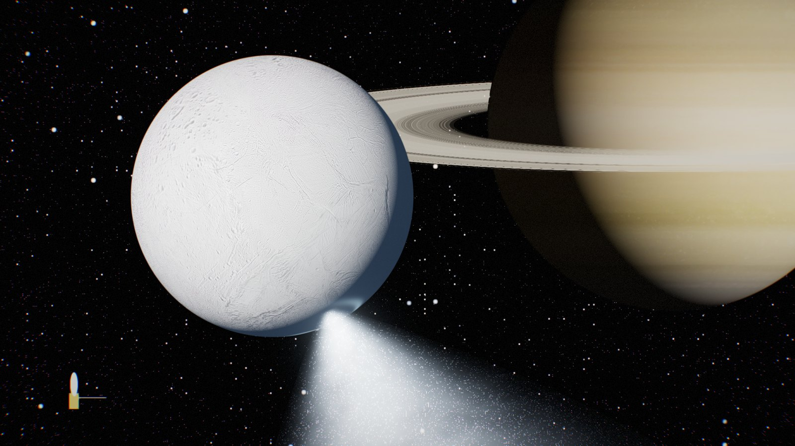
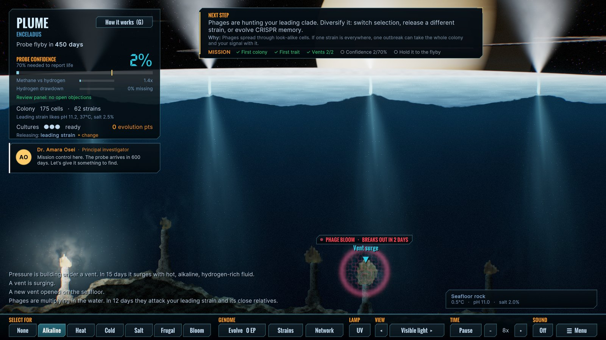
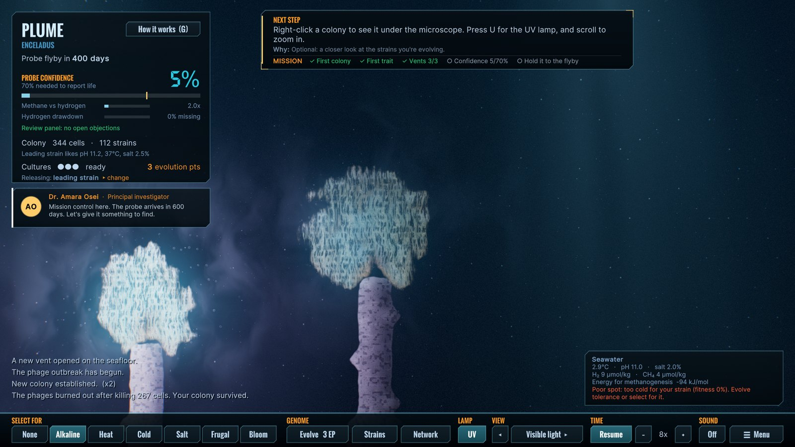
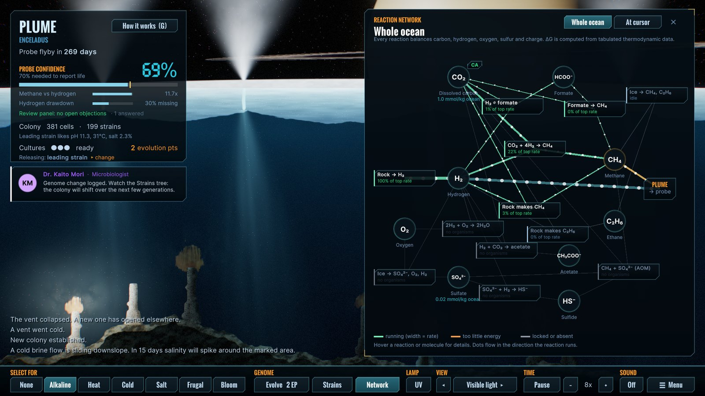
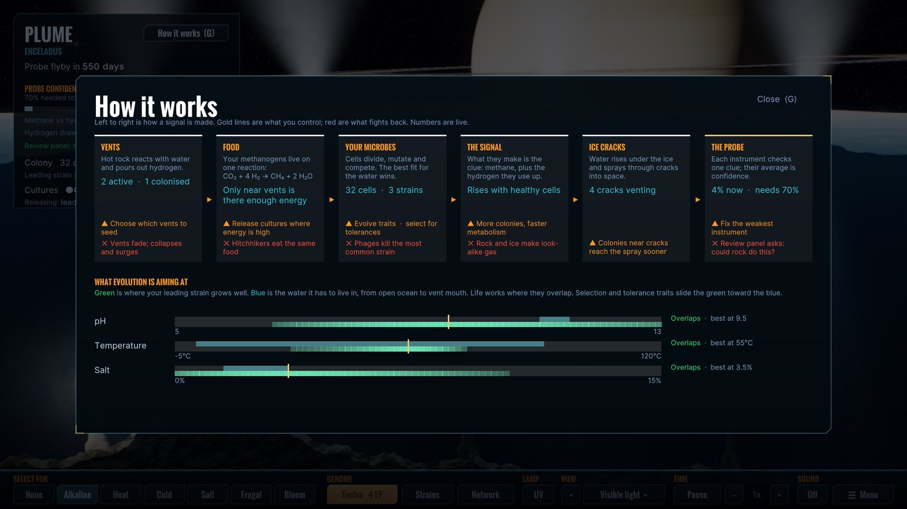
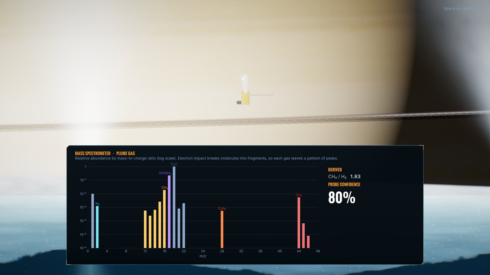
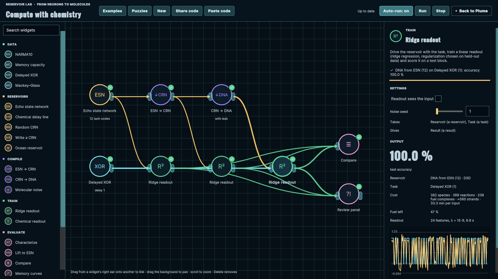
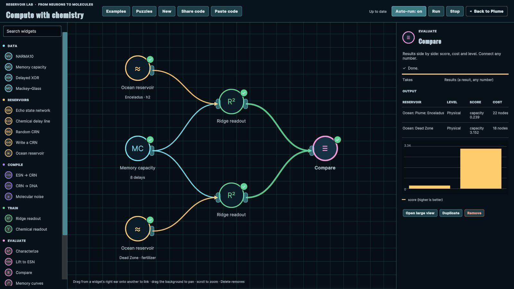
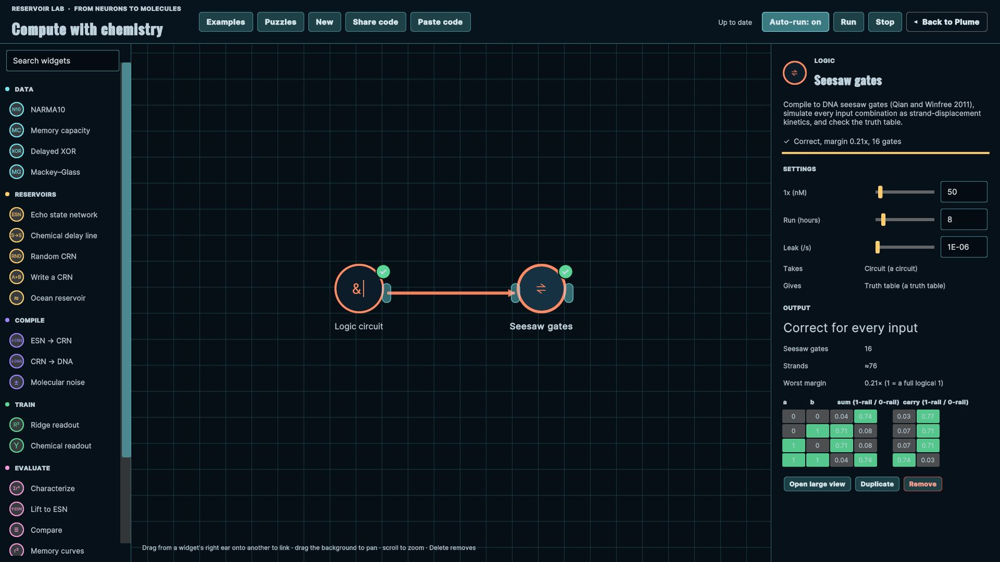

# Plume

**Seed life under the ice. Could a probe tell?**

### ▶ [Play it free in your browser](https://etcyl.github.io/plume-play/)

Plume is a free strategy game about one of the biggest open questions in planetary science: if
something lived in the ocean under an icy moon, could a spacecraft flying through its spray
actually detect it?

You release Earth microbes at hydrothermal vents on the seafloor of Enceladus, help them adapt by
evolving traits and steering their mutations, and try to make their chemical signal strong enough
in the plume for a passing probe to report life. That report has to hold up when a review panel
asks whether rock chemistry alone could explain it.

No download or account needed. Plume runs in a desktop browser (Chrome, Edge, Firefox or Safari)
with a mouse and keyboard.

## The science behind it

Plume is inspired by research published in *Science Advances* in September 2026:

- **Helmbrecht et al. (2026).** A methane-making microbe from deep-sea vents,
  *Methanothermococcus okinawensis*, grew in a lab recreation of Enceladus's seafloor at pH 9 to 11
  (it had never grown above pH 8.5 before), living on hydrogen from simulated rock–water reactions.
  The runs lasted 48 hours at 65 °C.
  [doi:10.1126/sciadv.aei0167](https://doi.org/10.1126/sciadv.aei0167)
- **Postberg et al. (2026).** Cassini's dust analyser shows the plume's ice grains freeze slowly
  and separate by composition, so a single grain could carry a concentrated signal.
  [doi:10.1126/sciadv.aee7256](https://doi.org/10.1126/sciadv.aee7256)
- News coverage: Ian Sample,
  [Earth microbes survive simulated conditions of Saturn moon's ocean](https://www.theguardian.com/science/2026/sep/25/earth-microbes-survive-conditions-enceladus-saturn-moon-ocean-study),
  *The Guardian*, 25 September 2026.

Neither paper is evidence of life on Enceladus. The game asks what it would take to detect it if
it were there. It is also a thought experiment: planetary-protection rules exist precisely to stop
Earth microbes from reaching these oceans.

Under the hood, the ocean runs a real chemical reaction network: every reaction is checked for
atom and charge balance, and microbes only grow where the reaction releases enough energy. The
probe reads the same clues scientists have proposed for Enceladus: methane relative to hydrogen,
missing hydrogen, carbon isotopes, methane versus ethane, and cells in ice grains. The in-game
**Science notes** say what is modelled from real data and what is simplified for play.

Further reading:
- Waite et al. 2017, *Science*: Cassini finds hydrogen in the plume.
  [doi:10.1126/science.aai8703](https://doi.org/10.1126/science.aai8703)
- Glein et al. 2025, *Icarus*: phosphates point to a pH of about 10–11.
  [doi:10.1016/j.icarus.2025.116717](https://doi.org/10.1016/j.icarus.2025.116717)
- Affholder et al. 2021, *Nature Astronomy*: is Enceladus's methane biological?
  [doi:10.1038/s41550-021-01372-6](https://doi.org/10.1038/s41550-021-01372-6)
- Klenner et al. 2024, *Science Advances*: finding cell material in a single ice grain.
  [doi:10.1126/sciadv.adl0849](https://doi.org/10.1126/sciadv.adl0849)
- Green et al. 2021, *Nature*: a confidence scale for claims of life beyond Earth.
  [doi:10.1038/s41586-021-03804-9](https://doi.org/10.1038/s41586-021-03804-9)

## What you'll do

- **Seed** cultures at warm, hydrogen-rich vents.
- **Evolve** traits with points from sample bubbles, and steer which mutations win.
- **Survive** phages that hunt your most common strain, vents that fade, and ice-methane bursts
  that can fool the probe.
- **Get detected:** push the probe's confidence to 70% by the flyby, then face the review panel.

Four missions (Enceladus, Europa and two hypothetical oceans), plus a Sandbox Lab where you design
your own metabolism, Survival Trials on a realistic Europa, Plume Studio for building and
sharing scenarios, and the Reservoir Lab (below).

| | |
|---|---|
|  |  |
| UV lamp: methanogens glow (F420 fluorescence) | The reaction network running underneath |
|  |  |
| How it works (press G) | The flyby's mass spectrum |

## New: the Reservoir Lab

### ▶ [Open the Reservoir Lab directly](https://etcyl.github.io/plume-play/?lab)

Can chemistry compute? The Reservoir Lab is a visual workflow, in the style of the Orange toolkit,
for *reservoir computing*: a fixed, messy dynamical system does the hard work and only a simple
readout is trained. Drop widgets on a canvas, link them, and everything re-runs as you edit.

- **Go down the ladder.** Build a reservoir as a neural network, compile it to a chemical
  reaction network, then to DNA strand displacement, and see what each step costs in accuracy,
  molecules and time (DNA computes at about one input every half hour).
- **Logic in DNA.** Write a Boolean circuit and run it as DNA seesaw gates, with every input
  combination simulated as strand-displacement chemistry.
- **Can an ocean compute?** Use a whole simulated ocean as the reservoir. Enceladus's vent plumes
  sense the present perfectly but forget it within a day; a coastal dead zone's algae and bacteria
  remember for about a week.
- **Survive the review panel**, which asks five questions: negative numbers, running out of fuel,
  leaky gates, molecular noise, and a readout that ran on a computer. Then try six compile-down
  puzzles.

| | |
|---|---|
|  |  |
| Two oceans as computers | A half adder in DNA seesaw gates |

The Lab follows Peter Banda's roadmap from neural models to chemical reaction networks and DNA
(PhD, Portland State, 2015), with the DNA compilers of Soloveichik, Seelig and Winfree (2010) and
Qian and Winfree (2011). It's named in the spirit of Oger, the "organic" reservoir computing
toolbox from Ghent (Verstraeten et al. 2012).

## Tips

- New players get a short tutorial, and a **Next step** banner always says what to do and why.
- Press **G** for a live diagram of the whole chain, from vent to probe.
- Press **H** for help, **Esc** for the menu and settings.
- Add `?lab` to the address to open straight into the Reservoir Lab (`?lab=1` loads the ocean
  example). In the Lab, double-click a widget for a large view and press **F** to fit the canvas.
- Slow? Press **F3** to see your frame rate and which graphics card the browser is using. Settings
  has graphics quality and automatic resolution.

## Credits

Made by [instructions unclear](https://github.com/etcyl). Built with Unity.

- Enceladus map: Cassini global mosaic (NASA/JPL-Caltech/Space Science Institute, compiled by
  USGS Astrogeology; public domain). Europa and Ganymede maps: NASA/JPL-Caltech (public domain).
- Saturn, its rings, Jupiter and Neptune: [Solar System Scope](https://www.solarsystemscope.com/),
  CC BY 4.0.

This repository hosts the playable web build only.
